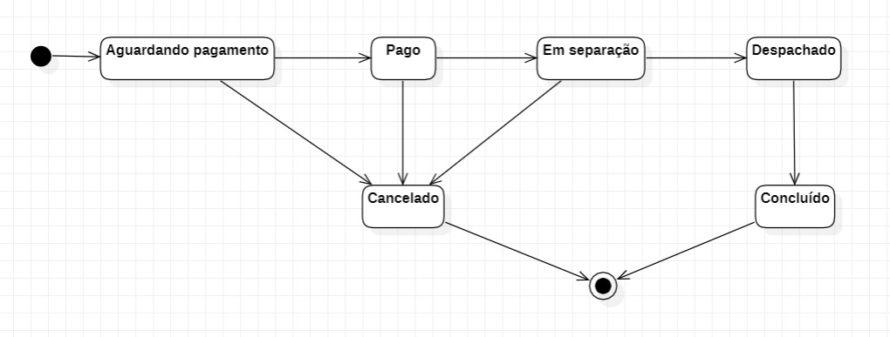
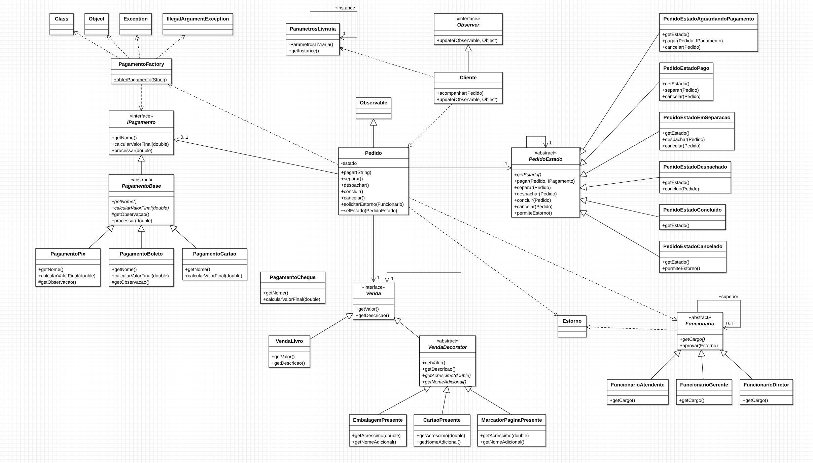

# Desafio Integração dos Padrões, Sistema de Livraria

#### Nome: João Vitor Fernandes Ribeiro Carneiro Ramos
#### Matrícula: 202165076C

Implementação dos padrões de projeto **Singleton**, **Factory Method**, **Template Method**, **Decorator**, **State**, **Observer** e **Chain of Responsibility** em Java.

## Diagramas UML

